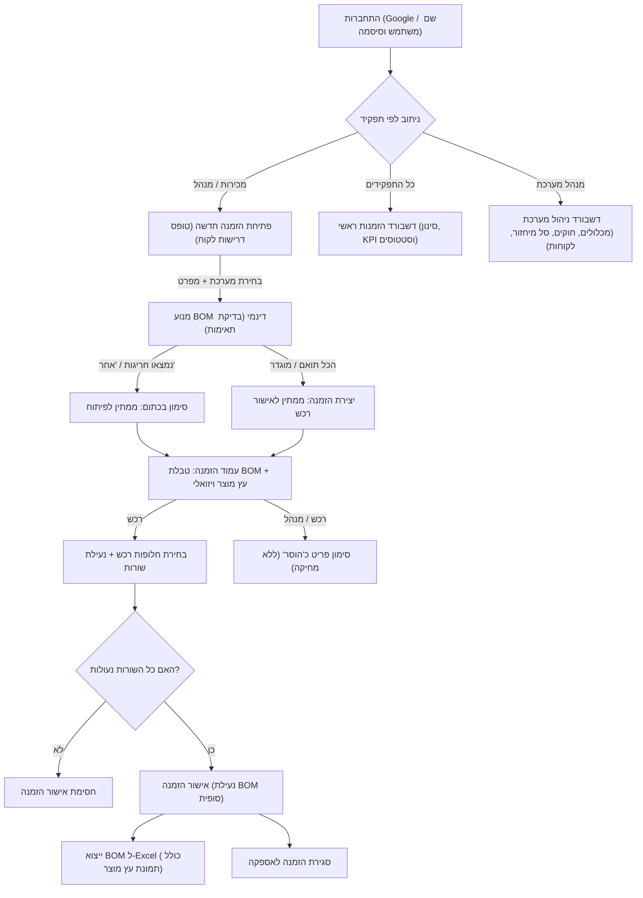
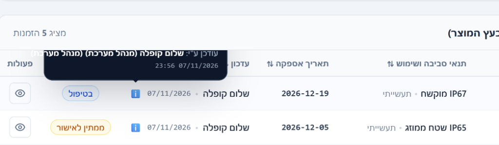
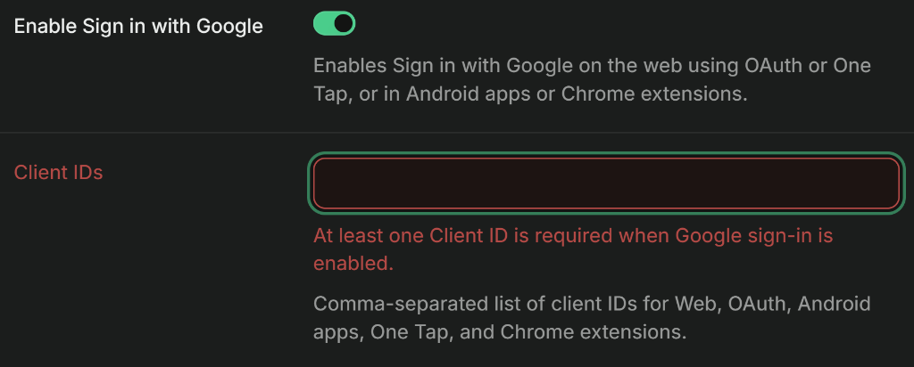
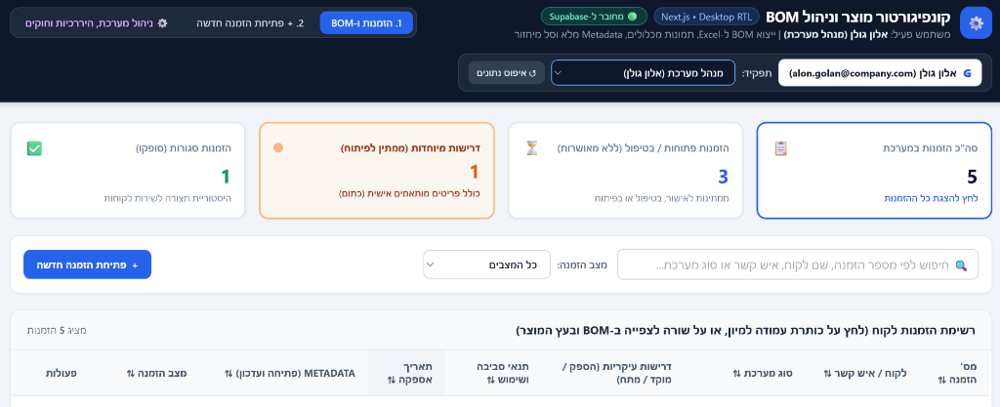
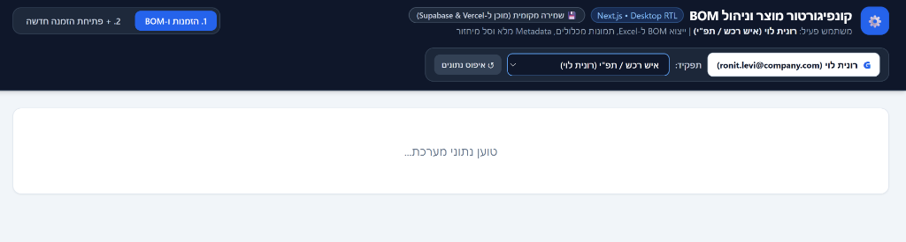
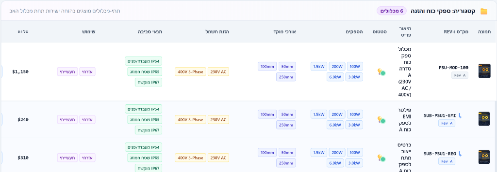
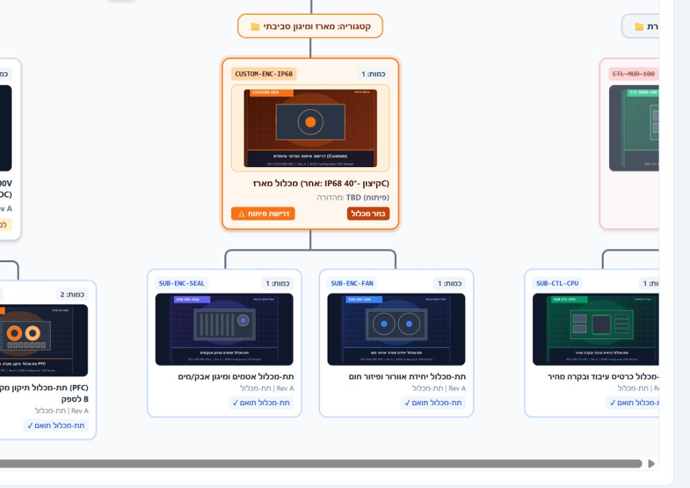
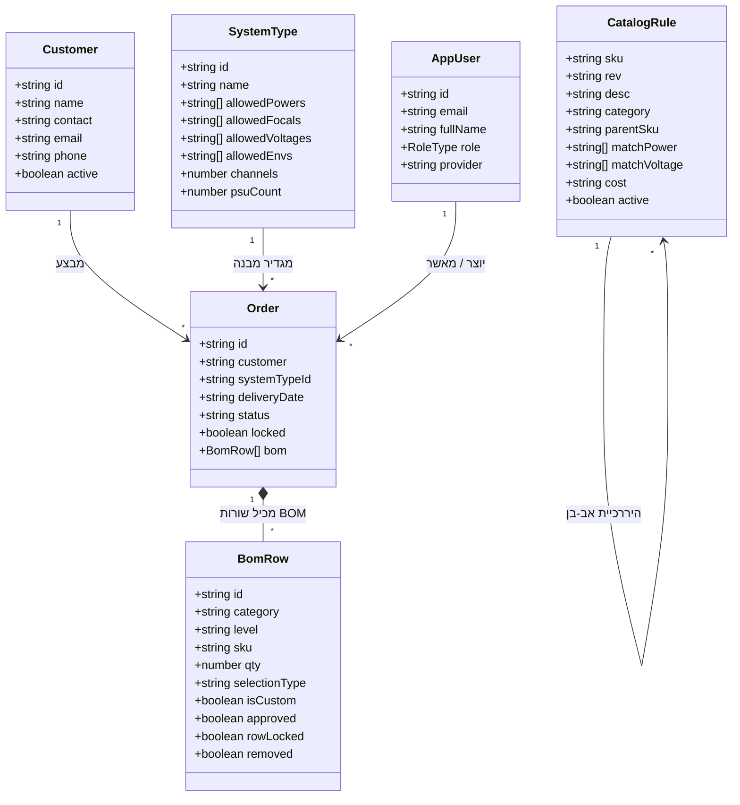

# מסמך הגשת פרויקט גמר – קורס AI לפיתוח יישומים ומערכות סוכנים

---

# 1. עמוד שער (Cover Page)

<div dir="rtl" align="center" style="font-family: Arial, sans-serif; padding: 40px 20px; border: 2px solid #e2e8f0; border-radius: 16px; background: linear-gradient(180deg, #f8fafc 0%, #ffffff 100%); margin-bottom: 40px;">

### המרכז ללימודי בינה מלאכותית ופיתוח תוכנה מתקדם
#### קורס פיתוח יישומים באמצעות סוכני AI אוטונומיים (Antigravity & Agentic Coding)

<br/>

# 🚀 קונפיגורטור מוצר – יצירת BOM לפי דרישת לקוח
## Product BOM Configurator & Hierarchical Tree Generator

<br/>

**פרויקט גמר יישומי (Capstone Project)**  
מערכת תצורה הנדסית, בניית עץ מוצר דינמי, ניהול תאימות מכלולים וסנכרון תהליכי עבודה ארגוניים

<br/><br/>

| פרט | מידע |
| :--- | :--- |
| **שם הסטודנט:** | **שלום קופלה (Shalom Kopla)** |
| **דואר אלקטרוני:** | `shalomkopla@gmail.com` |
| **סביבת פיתוח:** | **Google Antigravity IDE (Multi-Agent SDD Workflow)** |
| **מאגר קוד (GitHub):** | [https://github.com/shalomkopla-commits/BOM-CONFIGURATOR](https://github.com/shalomkopla-commits/BOM-CONFIGURATOR) |
| **תאריך הגשה:** | **נובמבר 2026 / חשוון ה'תשפ"ז** |

</div>

---

# 2. אפיון מלא (Original Specification – AS IS)

> סעיף זה משקף במלואו את האפיון המקורי של הפרויקט כפי שהוגדר במסמכי האפיון (`אפיון.docx` ו-`specs/SPEC.md`), המהווה את הבסיס ההנדסי לפיתוח.

### 2.1 הגדרת הבעיה והצורך העסקי
בארגונים המפתחים ומייצרים מערכות משולבות (חומרה, אופטיקה, לייזר, אלקטרוניקה ובקרה), המוצר הסופי נבנה ממספר רב של מכלולים ותתי-מכלולים המותאמים אישית לדרישות הלקוח (Custom Configurations).
במצב הקיים, קיים נתק תהליכי בין מחלקות הארגון:
1. **אנשי המכירות** סוגרים דרישות מול לקוחות מבלי להכיר את מגבלות התכנון הקיים, ומבטיחים מפרטים שלא קיימים בקטלוג.
2. **אנשי תפ"י ורכש** מגלים חוסרים במלאי או אי-התאמות טכניות רק בעת תחילת ההרכבה.
3. **מחלקת פיתוח והנדסה** מקבלת דרישות לפיתוח מיוחד (Custom) בשלב מאוחר מדי, ללא אפיון ברור.
4. **מחלקת ייצור** נאלצת לאלתר הרכבות "תוך כדי תנועה" בהיעדר עץ מוצר (BOM) מדויק ועדכני.
5. **שירות לקוחות** מתקשה לתמוך במערכות בשטח מאחר שאין תיעוד מהימן של הקונפיגורציה הספציפית שסופקה לכל לקוח.

### 2.2 קהל היעד ומטריצת הרשאות (Roles & Permissions - RBAC)
המערכת משרתת 6 תפקידים מוגדרים:
1. **איש מכירות (Sales):** מילוי טופס דרישות לקוח, הקמת לקוח חדש מתוך טופס ההזמנה, בחירת סוג מערכת ומפרט, צפייה ב-BOM הנגזר (קריאה בלבד), וביטול הזמנה.
2. **איש רכש / תפ"י (Procurement / Operations):** עריכת שורות BOM, בחירת חלופות מתוך מכלולים תואמים, נעילת שורות, סימון פריטים כ"הוסר" (🚫), ואישור הזמנה (הנועל את ה-BOM לעריכה).
3. **איש פיתוח / הנדסת מערכת (R&D / System Engineering):** מעקב אחר הזמנות הממתינות לפיתוח (דרישות "אחר" המסומנות בכתום), הגדרת מק"טים חלופיים או שיבוץ פתרון הנדסי.
4. **ייצור (Manufacturing):** צפייה ב-BOM המאושר, כמויות, היררכיה ותמונות מכלולים (קריאה בלבד).
5. **שירות לקוחות (Customer Support):** איתור היסטוריית הזמנות לפי לקוח או מספר הזמנה ובדיקת מפרט ה-As-Made.
6. **מנהל מערכת (Admin):** גישה מלאה לכל המסכים והפעולות, שחרור נעילת הזמנות, וניהול מלא של ישויות המערכת (מכלולים, מערכות, תאימות, סל מיחזור, לקוחות ומשתמשים).

### 2.3 תרשים זרימת משתמש (User Flow)


### 2.4 מודל מסד הנתונים (Database Schema)
הנתונים מנוהלים במבנה טבלאי רלציוני מלא:
1. **`catalog_rules` (מכלולים ותתי-מכלולים):** `sku`, `rev`, `desc`, `category`, `parent_sku` (ROOT או מק"ט אב), `match_power` (מערך), `match_focal` (מערך), `match_voltage` (מערך), `match_env` (מערך), `match_usage` (מערך), `cost`, `img_type`, `custom_img`, `active`.
2. **`system_types` (סוגי מערכות מוצר):** `id`, `name`, `allowed_powers`, `allowed_focals`, `allowed_voltages`, `allowed_envs`, `allowed_usages`, `channels`, `psu_count`, `active`, `cat_qty` (מפתח כמות לכל קטגוריה).
3. **`compat_links` (חוקי תאימות רכיבים):** `c1` (מק"ט מכלול 1), `c2_list` (מערך מק"טים מותרים), `note`.
4. **`orders` (הזמנות לקוח):** `id`, `customer`, `contact`, `email`, `phone`, `system_type_id`, `system_name`, `delivery_date`, `created_at`, `created_by`, `updated_at`, `updated_by`, `power`, `focal`, `voltage`, `env`, `usage`, `channels`, `psu_count`, `status`, `locked`, `bom` (מערך שורות BOM).
5. **`app_users` (משתמשי מערכת):** `id`, `email`, `username`, `password`, `full_name`, `avatar_url`, `role`, `provider`, `active`, `created_at`, `last_sign_in_at`.
6. **`customers` (לקוחות מנוהלים):** `id`, `name`, `contact`, `email`, `phone`, `address`, `notes`, `active`, `created_at`, `updated_at`.
7. **`recycle_bin` (סל מיחזור):** `recycle_id`, `item_type`, `sku_or_id`, `rev`, `name`, `category_or_details`, `deleted_by`, `deleted_at`, `delete_reason` (שדה חובה), `payload` (JSON מלא לשחזור).

---

# 3. תיאור האפליקציה שנבנתה ואופן מימוש הפתרון ב-ANTIGRAVITY

### 3.1 ארכיטקטורה וטכנולוגיות
האפליקציה פותחה ברמת Production-Grade באמצעות טכנולוגיות ה-Web המובילות:
- **Frontend Framework:** Next.js 14 (App Router) ב-TypeScript, עם תמיכה מלאה ב-Static HTML Export (`output: 'export'`) הפועל באופן עצמאי ללא תלות בשרת Node ייעודי.
- **Styling & UI:** Tailwind CSS עם עיצוב רספונסיבי מלא, התאמה מוחלטת לכיווניות עברית (RTL), ופלטת צבעים מודרנית (אינדיגו, סגול עמוק, אמרלד וכתום התראה).
- **ניהול תצוגה ומצב כהה:** מנוע Theme ייעודי התומך ב-**Light Mode** ו-**Dark Mode** מלא, הנשמר ב-`localStorage` ומחליף ערכות עיצוב בכל רכיבי המערכת.
- **שכבת נתונים וסנכרון היברידי:** מודול `src/lib/supabase.ts` המסנכרן נתונים בזמן אמת מול ענן **Supabase** (באמצעות `@supabase/ssr` ו-`@supabase/supabase-js`), וכולל מנגנון Fallback אוטומטי ל-`localStorage` המאפשר עבודה חלקה ואופליין בכל סביבה.
- **מנוע גרפיקה וייצוא נתונים:** שילוב של `ExcelJS` ו-Canvas 2D לצורך יצירת קובץ Excel מתקדם הכולל טבלאות נתונים היררכיות בגיליון הראשון, ודיאגרמת עץ מוצר גרפית ברזולוציה גבוהה בגיליון השני.

### 3.2 תהליך הפיתוח בסביבת Google Antigravity
הפיתוח בוצע כולו באמצעות סוכן ה-AI האוטונומי של **Google Antigravity**, תוך הקפדה על מתודולוגיית **Specification-Driven Development (SDD)**:
1. **שימור זיכרון והנחיות מרובות סוכנים (`AGENTS.md`):**
   כל ההחלטות הארכיטקטוניות, הגדרות התפקידים, דרישות המשתמש וסטטוס המשימות תועדו בקבצי הפרויקט, כך שרצף הפיתוח נשמר במלואו.
2. **אוטונומיה מלאה ופתרון תקלות עצמאי (Self-Healing Execution):**
   סוכן ה-AI פעל בצורה עצמאית מלאה: פתר שגיאות קומפילציה, התאים מודולים, התקין תלויות, ביצע בדיקות TypeCheck ב-TypeScript, בנה את הפרויקט בבילד סטטי מלא, ודחף את השינויים למאגר ה-GitHub.
3. **הנדסת מנוע החוקים (`src/lib/bomEngine.ts`):**
   - **התאמה רב-ממדית (Multi-Parametric Matching):** בדיקת 5 צירי תאימות במקביל (הספק, מוקד, מתח, סביבה ושימוש).
   - **מנגנון חלופות וסימון לבחירת רכש:** כאשר יותר ממכלול אחד מתאים לדרישות (לדוגמה: שני ספקי כוח שונים התומכים במתח הנדרש), המנוע מציג לאיש הרכש תפריט בחירה מתוך החלופות התואמות בלבד.
   - **איתור ושיבוץ תתי-מכלולים (Sub-Assembly Cascade):** גזירה אוטומטית של תתי-המכלולים המשויכים למכלול האב, והזחתם ההיררכית בעץ ובטבלה.
   - **זיהוי דרישות פיתוח (Custom Detection):** זיהוי מיידי של בחירת "אחר" או העדר מכלול מתאים, צביעת השורה בכתום בולט, והעברת ההזמנה לסטטוס `ממתין לפיתוח`.

### 3.3 פתרון אתגרי UI/UX מורכבים
1. **מניעת גלילה אופקית (Zero Horizontal Scroll - 100% Fit):**
   בעקבות משוב המשתמש על כך שהטבלה חורגת מרוחב המסך ומסתירה את עמודות העלות והפעולות, בוצע תכנון מחדש של מבנה הטבלה: הוסרו מגבלות רוחב קשיחות (`min-w-[130px]`), קוצרו תגיות ארוכות לתקן טכני חד (`IP54`, `400V 3P`) עם Tooltip מפורט בריחוף עכבר, וצומצמו הריווחים. כתוצאה מכך, הטבלה כולה נכנסת ב-100% מרוחב המסך ללא צורך בשום גלילה שמאלה.
2. **תריס עליון אינטראקטיבי (Top Shutter Drawer):**
   סרגל הניווט העליון מומש כמגירה מתכנסת הנסגרת אוטומטית כאשר העכבר עוזב את האזור, וכוללת חץ פתיחה מינימליסטי, כפתור נעיצה (📌 Pin) המאפשר להשאיר את התריס פתוח קבוע, ומתג מעבר מהיר בין מצב בהיר לכהה.
3. **הגדלת תמונה בריחוף (Hover Zoom Popover):**
   על מנת לאפשר זיהוי ויזואלי מדויק של מכלולים מבלי להעמיס על שורות הטבלה, שולבה תמונת ממוזערת אלגנטית (`w-11 h-8`) אשר במעבר עכבר פותחת חלונית צפה גדולה (256px) המציגה את תמונת המכלול ברזולוציה גבוהה לצד מק"ט ועלות.

---

# 4. צילומי מסך מלווים בהסברים (Screenshots & System Walkthrough)

להלן סקירה של מסכי המערכת המרכזיים עם צילומי המסך המתאימים:

### 4.1 דשבורד הזמנות ראשי (Screen 1 – Orders Dashboard)

- **מה רואים בתמונה:**
  - כרטיסיות KPI עליונות לסינון מהיר בלחיצה: סה"כ הזמנות, הזמנות פתוחות, ממתין לפיתוח (מודגש בכתום), הזמנות מאושרות, והזמנות סגורות.
  - סרגל חיפוש וסינון רב-פרמטרי (לפי לקוח, מספר הזמנה וסטטוס).
  - טבלת הזמנות מפורטת המציגה את מספר ההזמנה, שם הלקוח, סוג המערכת, תאריך האספקה, תגיות הסטטוס הצבעוניות, מטא-דאטה (מי פתח ומתי), וכפתורי פעולה מהירים (`צפה ב-BOM`, `שכפל הזמנה`, `בטל הזמנה`).
  - כפתור בולט לפתיחת הזמנה חדשה.

---

### 4.2 קונפיגורטור פתיחת הזמנה (Screen 2 – Order Configurator)

- **מה רואים בתמונה:**
  - בחירת לקוח מרשימה נפתחת דינמית (השואבת נתונים ממאגר הלקוחות המנוהל) או אפשרות להקמת לקוח חדש במקום.
  - בחירת תאריך אספקה מבוקש.
  - בחירת סוג מערכת – המסננת ומגבילה אוטומטית את שדות ההספק, המוקד, המתח והסביבה רק למה שהוגדר כמותר לאותה מערכת.
  - אפשרות בחירה של "אחר (דרישה מיוחדת)" הנצבעת מיידית ברקע כתום בולט.
  - מגירת תצוגה מקדימה חיה (Live BOM Preview) המתעדכנת בזמן אמת עם כל שינוי בטופס.

---

### 4.3 עמוד הזמנה וטבלת BOM היררכית (Screen 3 – Hierarchical BOM Table)

- **מה רואים בתמונה:**
  - מטא-דאטה מקיף בראש ההזמנה: מי פתח את ההזמנה ומתי, מי עדכן לאחרונה, סטטוס ההזמנה, וכפתורי פעולה (`ייצוא ל-Excel`, `אישור הזמנה`, `סגירת הזמנה`).
  - טבלת BOM היררכית: קטגוריות ראשיות, מכלולים ראשיים, ותתי-מכלולים המוצגים בהזחה (Indentation) עם חץ `↳`.
  - תמונות ממוזערות לכל מכלול עם מנגנון Zoom בריחוף עכבר.
  - ניהול שורות רכש: כפתורי עריכת שורה, תפריט חלופות לבחירת איש רכש, כפתור נעילת שורה, וכפתור סימון פריט כ"הוסר" (🚫) המשמר את השורה בטבלה עם קו חוצה.
  - שורות דרישת פיתוח המסומנות בכתום בולט.

---

### 4.4 עץ מוצר ויזואלי אינטראקטיבי (Screen 3 – Visual Product Tree)

- **מה רואים בתמונה:**
  - עץ מוצר גרפי היררכי המחבר בקווים ישירים בין 4 רמות: מערכת ראשית ⬅ קטגוריות ⬅ מכלולים ראשיים ⬅ תתי-מכלולים.
  - כרטיסים קומפקטיים וברורים לכל מכלול, הכוללים תמונה, מק"ט, כמות, וסטטוס פעילות.
  - פריטי Custom המסומנים במסגרת כתומה כפולה ובולטת.
  - כפתורי זום ושליטה (+, -, התאמה למסך) המאפשרים ניווט קל גם בעצי מוצר מורכבים.

---

### 4.5 דשבורד מנהל מערכת – קטלוג מכלולים 100% Fit (Screen 4 – Admin Dashboard)

- **מה רואים בתמונה:**
  - תצוגת קטלוג מכלולים לפי קטגוריות (לדוגמה: "קטגוריה: ספקי כוח והזנה [6 מכלולים]").
  - **התאמה מלאה לרוחב המסך (100% Fit):** כל העמודות – תמונה, מק"ט ו-Rev, תיאור פריט, נורית סטטוס (`💡`), תגיות הספקים, מוקדים, מתחים, סביבה, שימוש, עלות, וכפתורי פעולות (`✏️ עריכה`, `📋 שכפול`, `⏸️ השבתה`, `🗑️ מחיקה לסל מיחזור`) – מוצגות כולן בתוך המסך ללא גלילה שמאלה.
  - תגיות טכניות קומפקטיות וברורות (`IP54`, `400V 3P`, `230V`) המשמרות קריאות מקסימלית.
  - כותרת מתקפלת להוספת מכלול חדש (`+ הוסף מכלול`).

---

### 4.6 ייצוא מתקדם ל-Excel עם דיאגרמת עץ גרפית (Excel Export Engine)

- **מה רואים בתמונה:**
  - קובץ ה-Excel המופק בלחיצה על כפתור `📊 ייצוא BOM ל-Excel`.
  - **גיליון 1 (BOM מפורט):** טבלת נתונים מלאה בכיוון RTL עם כותרת מעוצבת, פרטי הזמנה, כל שורות המכלולים, סימון שורות שהוסרו בקו חוצה וצבע אדום, ושורות פיתוח בכתום.
  - **גיליון 2 (עץ מוצר ויזואלי):** תמונה גרפית יחידה ואיכותית שנוצרה באמצעות Canvas 2D המציגה את דיאגרמת עץ המוצר הוויזואלי במלואה, מוכנה להדפסה ולהצגה מול לקוחות והנהלה.

---

### 4.7 תצוגת ה-Data Model וההרשאות מתוך המערכת


---

# 5. קישורים פעילים והוראות הרצה (Live URLs & Source Code)

### 5.1 קישורים פעילים
- **מאגר הקוד הרשמי ב-GitHub:**  
  🔗 [https://github.com/shalomkopla-commits/BOM-CONFIGURATOR](https://github.com/shalomkopla-commits/BOM-CONFIGURATOR)
- **קישור פריסה פעיל (Live Web App):**  
  🌐 [https://bom-configurator-30337869.base44.app](https://bom-configurator-30337869.base44.app)

### 5.2 הרצה מקומית עצמאית (Local Reproduction Steps)
הפרויקט בנוי כפרויקט Next.js תקני לחלוטין וניתן להרצה מיידית בכל מחשב:
```bash
# 1. שכפול המאגר מ-GitHub
git clone https://github.com/shalomkopla-commits/BOM-CONFIGURATOR.git
cd BOM-CONFIGURATOR

# 2. התקנת תלויות
npm install

# 3. הרצת שרת הפיתוח המקומי
npm run dev
```
האפליקציה תיפתח מיידית בדפדפן בכתובת: **`http://localhost:3000`**

### 5.3 פרטי התחברות מהירים לבודקים (Demo Credentials)
- **התחברות באמצעות Google:** לחיצה על כפתור `התחבר באמצעות חשבון Google` (כניסה אוטומטית).
- **התחברות כמנהל מערכת (Admin):**
  - **שם משתמש:** `shalom.kopla`
  - **סיסמה:** `123456`
- **התחברות כאיש מכירות (Sales):**
  - **שם משתמש:** `yossi.cohen`
  - **סיסמה:** `123456`
- **התחברות כאיש רכש / תפ"י (Procurement):**
  - **שם משתמש:** `ronit.levi`
  - **סיסמה:** `123456`
